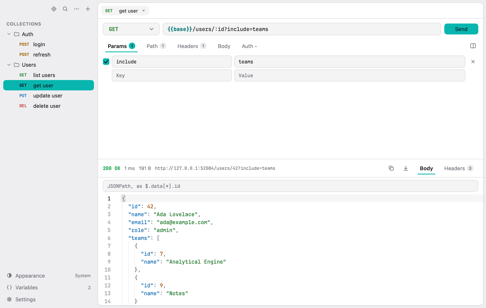

# Telepath

A small, native desktop API client for macOS: a tree of folders and requests, tabs, a request editor, one set of variables. No accounts, no cloud, no scripts. Your requests live in a single JSON file on your machine.

Telepath is written in Go with the [MyGo](https://github.com/egoist/mygo) native UI toolkit, so there is no web view or Electron inside.

<picture>
  <source media="(prefers-color-scheme: dark)" srcset="docs/screenshot-dark.png">
  
</picture>

## Features

- **Sidebar tree** of folders and requests: drag and drop to reorder or move into folders, rename inline (Enter), duplicate, context menu.
- **Tabs** for open requests, restored with their layout when you reopen the app.
- **Request editor**: method, URL, query Params kept in sync with the URL both ways, `:name` Path parameters, Headers (with name suggestions), and a Body as JSON, Text, form URL-encoded or multipart (with files).
- **Auth**: Basic, Bearer token and API key (header or query). A Bearer JWT shows its decoded claims under the token, with `exp`/`iat`/`nbf` as dates.
- **Variables**: one set of `{{name}}` variables, highlighted where you type them, suggested as you type `{{`, with their value on hover. Secret variables are masked.
- **Response viewer**: status, time, size, the resolved URL, pretty-printed and highlighted JSON, headers, copy and save. A JSONPath filter ([RFC 9535](https://www.rfc-editor.org/rfc/rfc9535)) narrows down large JSON bodies. The response pane can sit below or to the right of the request.
- **Search** (⌘K): fuzzy search across request names, folders, methods and URLs, accent-insensitive.
- **Import / export**: Telepath's own JSON and Postman Collection v2.1 in both directions; paste a `curl …` command into the URL field, or copy any request as cURL.
- **Customizable shortcuts**, light/dark/system appearance, and a choice of code font and size.
- **Secrets encrypted at rest**: passwords, tokens, API keys and secret variables are encrypted with AES-GCM in the workspace file, with the key kept in the macOS Keychain.

Out of scope on purpose: pre/post scripts, tests, multiple environments, folder-level variables or auth, cookie jar, WebSocket/gRPC/GraphQL, sync and history.

## Installation

### Requirements

- macOS on Apple silicon (builds target `darwin-arm64`)
- Go 1.27.3 or newer
- Xcode Command Line Tools (`xcode-select --install`), for cgo and code signing

### Build and install

```sh
git clone https://github.com/prometheusalpha/telepath.git
cd telepath
./install.sh
```

`install.sh` builds the app, signs it, verifies the signature and copies it to `/Applications/telepath.app`, replacing any previous copy (quit Telepath first). It signs with a certificate named `Telepath Local Signing` when your Keychain has one, ad hoc otherwise; set `SIGN_IDENTITY` to use another certificate:

```sh
security find-identity -v -p codesigning   # list your signing identities
SIGN_IDENTITY="Apple Development: …" ./install.sh
```

A stable certificate keeps the app's signature the same from build to build, so macOS doesn't ask again for access to the Keychain after each update.

To only build the app bundle, into `build/darwin-arm64/telepath.app`:

```sh
go tool mygo build -skip-dmg
```

## Usage

Run it from `/Applications`, or straight from the source:

```sh
go run .
```

A quick tour:

1. Create a request with ⌘N (or the `+` in the sidebar) and type a URL. Use `:id` in the path to get a Path parameter.
2. Open **Variables** (⌘E) and add, say, `base` = `https://api.example.com`; then write the URL as `{{base}}/users/:id`.
3. Send with ⌘↵. Type a JSONPath such as `$.items[*].id` in the filter above the response body to narrow it down.
4. Already have a Postman collection or a cURL command? Use **File > Import Collection…** (⌘O) or **Import cURL…** (⇧⌘O), or paste the `curl` command into the URL field.

Default shortcuts (change them in **Settings > Shortcuts**):

| Action | Keys |
| --- | --- |
| New request / new folder | ⌘N / ⇧⌘N |
| Send request | ⌘↵ |
| Focus URL | ⌘L |
| Search | ⌘K |
| Variables | ⌘E |
| Import collection / cURL | ⌘O / ⇧⌘O |
| Close tab / other tabs | ⌘W / ⇧⌘W |
| Go to tab 1…8 / last tab | ⌘1…⌘8 / ⌘9 |
| Settings | ⌘, |

In the sidebar, Enter renames the selected row and ⌘↓ opens it.

### Where your data lives

Everything is saved automatically to `~/Library/Application Support/telepath/`:

- `workspace.json`: folders, requests, variables and settings. Secrets are stored as `enc:v1:…`; everything else is plain JSON.
- `session.json`: open tabs and pane sizes.

The encryption key is in the login Keychain (service `io.starchaser.telepath.key`). Back it up along with `workspace.json`, or use **Export Collection…**, which writes secrets in plain text so the file works on another machine.

## Support

Found a bug or have a question? Open an issue on [GitHub](https://github.com/prometheusalpha/telepath/issues).

## Roadmap

The scope and the history of each phase are in [PLAN.md](PLAN.md) (in Vietnamese). Telepath aims to stay small: new features should fit the scope described there rather than grow it.

## Contributing

Pull requests are welcome; for anything larger than a fix, please open an issue first to talk about it.

```sh
go tool mygo dev                    # run with live reload
go vet ./... && go test ./...
CGO_ENABLED=1 go test -race ./...   # when touching goroutines
```

The code is organised as:

| Path | What it holds |
| --- | --- |
| `main.go` | Entry point; calls `app.Run()` |
| `internal/app` | The whole UI: sidebar, tabs, editor, response, settings |
| `internal/model` | Workspace, folder/request tree, URL ↔ query sync |
| `internal/store` | Loading and saving `workspace.json`, secret encryption |
| `internal/httpx` | Building and sending requests, auth, JSON formatting |
| `internal/vars` | Finding and expanding `{{name}}` |
| `internal/importx` | Native and Postman import/export, cURL parsing and output |
| `internal/jsonpath` | The JSONPath engine for the response filter |

UI tests drive the app like a user with MyGo's `ui.NewTester`. [CLAUDE.md](CLAUDE.md) lists the conventions and the non-obvious behaviour of each part (in Vietnamese); read the relevant section before changing one.

## Authors and acknowledgment

Made by [prometheusalpha](https://github.com/prometheusalpha). Built on [MyGo](https://github.com/egoist/mygo) by EGOIST; the embedded code font is JetBrains Mono (Nerd Font build).

## Project status

Actively developed for personal use. All phases planned in [PLAN.md](PLAN.md) are done; version 0.1.0.
